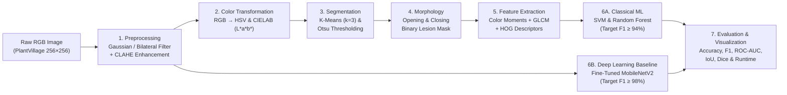

# 🌿 Safe Gardens: Automated Detection and Classification of Plant Leaf Diseases

> **Course:** ARTI 403 – Image Processing  
> **Institution:** Imam Abdulrahman Bin Faisal University (IAU) — College of Computer Science & Information Technology  
> **Group:** Group 2  
> **Subtitle:** *Using Color Space Segmentation, Texture Feature Analysis, and Deep Learning*


---

## 📖 Overview & Problem Statement

Plant diseases account for an estimated **20% to 40% loss** in annual global crop yields. Fungal, bacterial, and viral infections manifest as necrotic spots and chlorotic lesions on plant foliage, causing severe damage to essential crops—such as tomato, potato, corn, apple, and grape—when misdiagnosed during early growth stages.

Traditional field monitoring relies on periodic visual inspection by agronomists or laboratory chemical assays. However, manual scouting is subjective, labor-intensive, and difficult to scale across large acreage, while laboratory testing is slow and costly.

**Safe Gardens** provides an objective, automated **Digital Image Processing (DIP)** and **Machine Learning** pipeline for plant leaf disease detection and classification:
1. **Spatial Filtering & Contrast Enhancement:** Gaussian and bilateral filtering for edge-preserving noise reduction, coupled with **CLAHE** to normalize non-uniform illumination.
2. **Color Space Transformation & Segmentation:** Conversion from RGB to **HSV** and **CIELAB ($L^*a^*b^*$)** followed by **K-means clustering ($k=3$)** and **Otsu thresholding** to isolate diseased tissue.
3. **Morphological Post-Processing:** Opening and closing operations to eliminate background noise, fill lesion gaps, and extract accurate binary lesion masks.
4. **Multi-Modal Feature Extraction:** Combining **Color Moments**, **Gray-Level Co-occurrence Matrix (GLCM)** texture descriptors, and **Histogram of Oriented Gradients (HOG)** shape descriptors.
5. **Classification & Deep Learning Benchmarking:** Training classical classifiers (**SVM** and **Random Forest**) on handcrafted DIP features and benchmarking them against a GPU-accelerated, fine-tuned **MobileNetV2** Convolutional Neural Network (CNN).

---

## 🏗️ End-to-End Pipeline Architecture



---

## 👥 Group 2 — Team Members & Responsibilities

| # | Team Member | Student ID | Project Role | Assigned Core Responsibilities | Primary Module |
| :-: | :--- | :---: | :--- | :--- | :--- |
| **1** | **Nawaf Rabee Shahbal** *(Team Leader)* | `2240009025` | **Project Lead & Pipeline Architect** | Project coordination, literature review, dataset setup, end-to-end pipeline integration, and final IEEE paper compilation. | [`paper/`](./paper/), [`src/`](./src/) |
| **2** | **Abbas Abdulaziz Al Thunayan** | `2240004112` | **DIP Preprocessing Specialist** | Image ingestion, resizing ($256 \times 256$), Gaussian and bilateral filtering, and CLAHE contrast enhancement. | [`src/preprocessing/`](./src/preprocessing/) |
| **3** | **Mohammed Nasser Al-Marhoon** | `2240005893` | **Color Segmentation Lead** | Color space conversion (RGB to HSV / CIELAB $L^*a^*b^*$), K-means clustering ($k=3$), and Otsu thresholding. | [`src/segmentation/`](./src/segmentation/) |
| **4** | **Faisal Abdullah Alshehri** | `2240001737` | **Morphology & Feature Analyst** | Morphological operations (opening/closing), lesion boundary extraction, and GLCM & color moment feature extraction. | [`src/morphology/`](./src/morphology/), [`src/features/`](./src/features/) |
| **5** | **Saad Abdulaziz Alshehri** | `2240006495` | **Machine Learning & CNN Developer** | HOG feature computation, classical classifier training (SVM, Random Forest), and MobileNetV2 CNN benchmarking on GPU/Colab. | [`src/features/`](./src/features/), [`src/models/`](./src/models/) |
| **6** | **Mohammed Sameer Alajlan** | `2240002025` | **Evaluation & Visualization Lead** | Quantitative evaluation (Accuracy, Precision, Recall, F1, ROC-AUC, IoU, Dice, confusion matrix), plots, and presentation slides. | [`src/evaluation/`](./src/evaluation/), [`presentation/`](./presentation/) |

---

## 📂 Repository Structure

```text
ImageProcessingProject(IPP)/
├── Documents/                  # Official course guidelines & submitted project proposal
│   ├── ARTI 403 - Project Guidelines.pdf
│   ├── ARTI 403 - ProjectProposalGroup2.docx
│   └── README.md
├── data/                       # Dataset storage, stratified splits, and sample images
│   ├── raw/                    # Original PlantVillage dataset (ignored by Git)
│   ├── processed/              # Filtered & CLAHE-enhanced images (ignored by Git)
│   ├── splits/                 # Stratified train (70%), val (15%), test (15%) manifests
│   ├── samples/                # Small set of sample leaf images for quick testing & demos
│   └── README.md
├── notebooks/                  # Step-by-step Jupyter Notebooks for experimentation & demos
│   └── README.md
├── src/                        # Modular Python source code for the DIP & ML pipeline
│   ├── __init__.py
│   ├── preprocessing/          # Resizing, Gaussian/bilateral filtering, CLAHE
│   ├── segmentation/           # RGB → HSV/CIELAB conversion, K-means (k=3), Otsu
│   ├── morphology/             # Opening, closing, hole filling, lesion boundary masks
│   ├── features/               # Color moments, GLCM texture descriptors, HOG features
│   ├── models/                 # SVM, Random Forest, and MobileNetV2 CNN architectures
│   ├── evaluation/             # Metrics (F1, ROC-AUC, IoU, Dice), confusion matrices, plots
│   └── README.md
├── results/                    # Experimental outputs, visual comparisons, and metrics
│   ├── figures/                # Exported plots, filter comparisons, confusion matrices
│   ├── masks/                  # Generated binary lesion masks & segmentation overlays
│   ├── metrics/                # Quantitative evaluation tables (CSV / JSON)
│   ├── models/                 # Trained model weights & checkpoints (ignored by Git)
│   └── README.md
├── paper/                      # IEEE conference research paper drafts, figures & report
│   ├── drafts/                 # Word (.docx) / LaTeX manuscript drafts & final PDF
│   ├── figures/                # High-resolution figures formatted for the IEEE paper
│   └── README.md
├── presentation/               # In-class project presentation slide deck & visual assets
│   ├── assets/                 # Diagrams and media for presentation slides
│   └── README.md
├── .gitattributes              # Git line-ending normalization
├── .gitignore                  # Ignored datasets, caches, checkpoints, and virtual envs
├── CONTRIBUTING.md             # Team Git workflow, branch naming, and coding standards
├── requirements.txt            # Python package dependencies
└── README.md                   # Project overview (this file)
```

---

## 📊 Dataset Information

We use the publicly available **PlantVillage Dataset** (Hughes & Salathé, Penn State University / EPFL):

- **Total Images:** ~54,306 RGB leaf images
- **Categories:** 38 crop-disease pairs spanning 14 crop species (healthy and infected foliage)
- **Format & Resolution:** RGB color images (`JPG` / `PNG`), standardized to $256 \times 256$ pixels
- **Data Partitioning:** Stratified split into **70% Training**, **15% Validation**, and **15% Testing** across all classes to prevent data leakage and ensure balanced evaluation.
- **Official Sources:**
  - [Mendeley Data Repository (PlantVillage)](https://data.mendeley.com/datasets/tywbtsjrjv/1)
  - [Kaggle Mirror (PlantDisease)](https://www.kaggle.com/datasets/emmarex/plantdisease)

See [`data/README.md`](./data/README.md) for download and directory setup instructions.

---

## 🚀 Getting Started

### 1. Clone the Repository
```bash
git clone <repository-url>
cd "ImageProcessingProject(IPP)"
```

### 2. Create & Activate a Virtual Environment
```powershell
# Windows (PowerShell)
python -m venv .venv
.\.venv\Scripts\Activate.ps1
```
```bash
# macOS / Linux
python3 -m venv .venv
source .venv/bin/activate
```

### 3. Install Dependencies
```bash
pip install -r requirements.txt
```

---

## 🎯 Expected Outcomes & Evaluation Criteria

| Component | Target / Metric | Description |
| :--- | :--- | :--- |
| **Lesion Segmentation** | **IoU & Dice Coefficient** | Clean binary masks isolating necrotic and chlorotic disease spots from healthy leaf tissue. |
| **Classical DIP + ML** | **F1-Score $\ge 94\%$** | Handcrafted multi-modal features (Color Moments + GLCM + HOG) with **SVM** and **Random Forest**. |
| **Deep Learning Baseline** | **F1-Score $\ge 98\%$** | Fine-tuned **MobileNetV2** trained with GPU acceleration on Google Colab. |
| **Diagnostic Metrics** | **Accuracy, Precision, Recall, F1, ROC-AUC** | Evaluated on the held-out 15% stratified test split with per-class confusion matrices. |
| **Efficiency Benchmark** | **Inference Time (ms/img), Model Size (MB)** | Computational trade-off analysis between classical DIP pipelines and deep CNNs. |

---

## 📅 Project Timeline & Milestones

| Milestone / Activity | Target Completion | Status |
| :--- | :---: | :---: |
| **1. Problem Identification & Literature Review (Proposal)** | Week 8 (Oct 17, 2026) | ✅ Completed |
| **2. Dataset Collection & Stratified Preparation** | Week 9 (Oct 24, 2026) | 🔄 In Progress |
| **3. DIP Pipeline & Method Implementation** | Week 10 (Oct 31, 2026) | ⏳ Planned |
| **4. Classical ML & CNN Experiments / Evaluation** | Week 11 (Nov 7, 2026) | ⏳ Planned |
| **5. Analysis of Results & Visualization** | Week 12 (Nov 14, 2026) | ⏳ Planned |
| **6. Final IEEE Research Paper, Code & Presentation** | Week 13 (Nov 21, 2026) | ⏳ Planned |

---

## 📚 Key References

1. **S. P. Mohanty, D. P. Hughes, and M. Salathé**, "Using deep learning for image-based plant disease detection," *Frontiers in Plant Science*, vol. 7, p. 1419, Sep. 2016, doi: `10.3389/fpls.2016.01419`.
2. **V. Singh and A. K. Misra**, "Detection of plant leaf diseases using image segmentation and soft computing techniques," *Information Processing in Agriculture*, vol. 4, no. 1, pp. 41–49, Mar. 2017, doi: `10.1016/j.inpa.2016.10.005`.
3. **S. Ramesh et al.**, "Plant disease detection using machine learning," in *Proc. 2018 Int. Conf. Design Innovations for 3Cs Compute Communicate Control (ICDI3C)*, Bangalore, India, 2018, pp. 41–45, doi: `10.1109/ICDI3C.2018.8584513`.
4. **D. P. Hughes and M. Salathé**, "An open access repository of images on plant health to enable the development of mobile disease diagnostics," *arXiv preprint arXiv:1511.08060*, Nov. 2015.
5. **R. C. Gonzalez and R. E. Woods**, *Digital Image Processing*, 4th ed. New York, NY, USA: Pearson, 2018.
